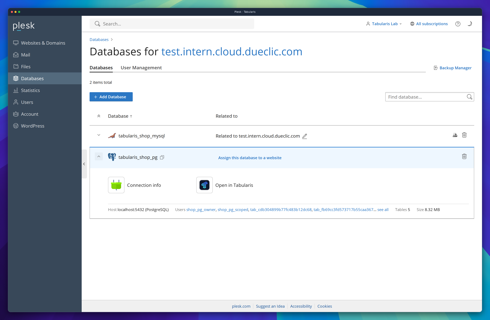
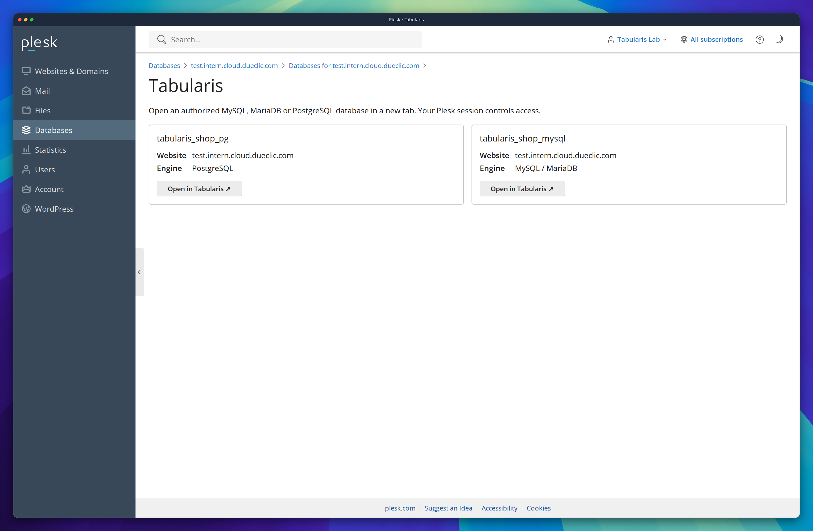
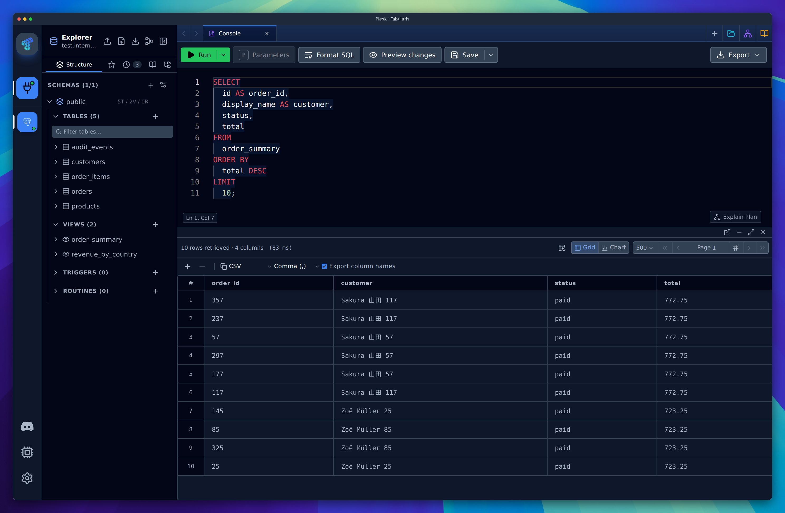
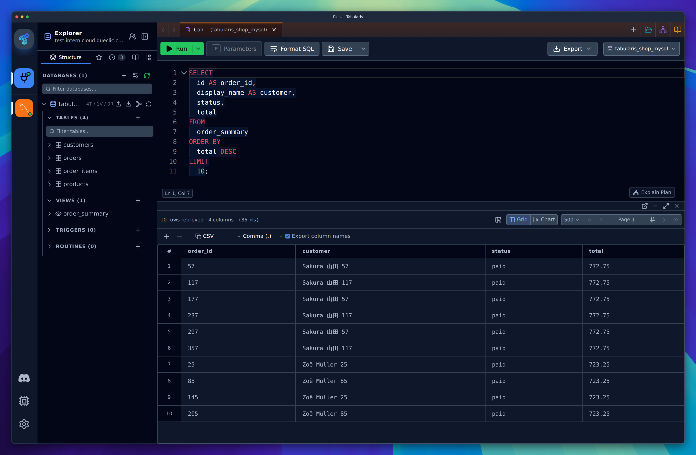
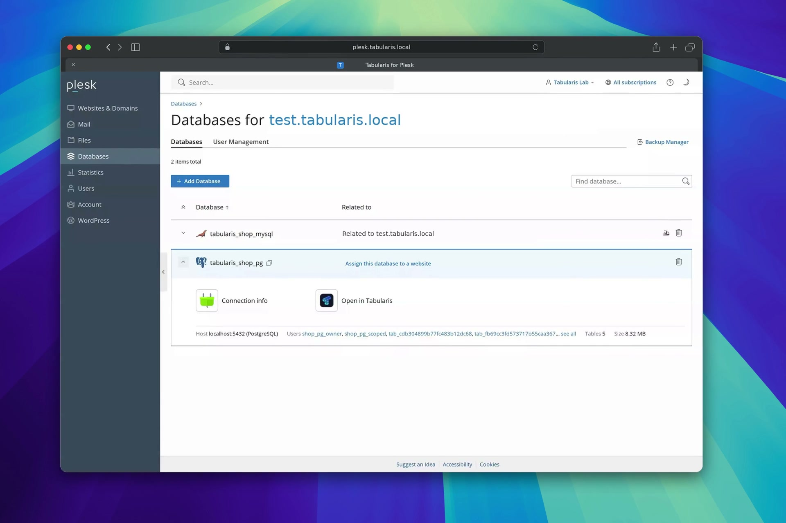

<div align="center">
  <picture>
    <source media="(prefers-color-scheme: dark)" srcset="https://raw.githubusercontent.com/TabularisDB/tabularis/main/.github/assets/banner-dark.png" />
    
  </picture>
</div>

# tabularis-plesk-extension

<p align="center">
  <a href="https://github.com/TabularisDB/tabularis-plesk-extension/actions/workflows/check.yml"></a>
  <a href="LICENSE"></a>
</p>

A native [Plesk](https://www.plesk.com/) Linux extension for [Tabularis](https://github.com/TabularisDB/tabularis), the open-source database client. Open a permitted **MySQL, MariaDB or PostgreSQL** database from Plesk and start working in the browser, using your existing panel session.

The extension resolves database access from Plesk, starts a separate unprivileged Tabularis Web workspace for each session and effective catalogue, and provisions dedicated database accounts without changing application passwords.

> **Evaluation implementation, not a released extension.** The required core changes remain in open, unmerged pull requests. Installation requires a pinned Tabularis Web build with managed connections, provisioning, runtime base paths and per-request proxy authentication. See [runtime installation](docs/runtime.md) for the tested revision and contract.

## Table of Contents

- [Features](#features)
- [Screenshots](#screenshots)
- [Video](#video)
- [Requirements and Configuration](#requirements-and-configuration)
- [Installation](#installation)
- [How It Works](#how-it-works)
- [Supported Operations](#supported-operations)
- [Building from Source](#building-from-source)
- [Development](#development)
- [Compatibility and Limitations](#compatibility-and-limitations)
- [Maintainers](#maintainers)
- [License](#license)

## Features

- **Native database actions** — “Open in Tabularis” appears in each authorized database card’s expanded actions. A responsive Tabularis panel page also lists accessible databases.
- **Plesk sign-in** — The current panel session controls every request; no second password form or credentials in launch URLs.
- **MySQL, MariaDB and PostgreSQL** — Browse schemas, tables and views, run queries and edit data with dedicated scoped accounts.
- **Separate workspaces** — Different panel sessions or effective permissions get separate Unix users, processes, connection stores and secrets. Tabularis never runs as root.
- **Managed connections** — Plesk supplies the server-controlled catalogue through Tabularis’s protected provisioning API. Browser users cannot add arbitrary connections.
- **Live revocation** — Fresh requests check current permissions; active HTTP and WebSocket streams are rechecked every two seconds. Failed authorization closes the stream before account cleanup.
- **Native services** — A small broker and gateway run under systemd. No nested Docker installation or Docker socket access is required.
- **Deliberate lifecycle** — Idle workspaces expire, generated accounts are revoked and failed cleanup remains in protected recovery journals. Application passwords are unchanged.

## Screenshots

Captured from the actual Plesk lab and live Tabularis editors, using sample data. Decorative framing follows the [Tabularis governance media tools](https://github.com/TabularisDB/governance/tree/main/scripts/release-media); application UI and results are real. See [capture notes](assets/README.md).

<table>
<tr>
<td><br />Native database card action</td>
<td><br />Authorized database catalogue</td>
</tr>
<tr>
<td><br />PostgreSQL editor</td>
<td><br />MySQL editor</td>
</tr>
</table>

## Video

[](assets/videos/plesk-database-workflow.mp4)

[Watch the Plesk → Tabularis database workflow](assets/videos/plesk-database-workflow.mp4) · [View the GIF](assets/videos/plesk-database-workflow.gif). The recording uses the real panel and editors with a decorative Safari-style window frame; it is not a Safari or macOS capture. Public identifiers are replaced with the local demo labels `plesk.tabularis.local` and `test.tabularis.local`; the full application viewport and query results remain visible during eased window movements. Long loading waits are shortened.

## Requirements and Configuration

| Requirement | Value |
| --- | --- |
| Plesk | Linux / Obsidian 18.0.59+; tested on 18.0.82.3 |
| Validated operating system | Ubuntu 24.04 |
| Panel PHP | 8.1+ |
| Python | 3.10+ and `python3-aiohttp` |
| Services | systemd and Plesk’s panel web server |
| Tabularis | Pinned Web binary and frontend assets, owned by root and not writable by other users |
| Database servers | Plesk-managed MySQL/MariaDB and local PostgreSQL |
| Public origin | Exact HTTPS panel origin, including a non-default port |
| Reverse proxy | Optional; trust only explicit proxy IPs and discard client-supplied forwarding headers |

The installer accepts `--binary`, `--sha256`, `--web-root`, `--public-origin` and optional repeated `--trusted-panel-proxy` addresses. It checks the supplied binary and retains existing signing keys. Nothing downloads or executes an arbitrary latest release.

## Installation

1. Build the extension ZIP from the reviewed branch:

   ```sh
   python3 scripts/package.py
   ```

2. On the Plesk host as root, install the ZIP and Python dependency:

   ```sh
   apt-get install --no-install-recommends python3-aiohttp
   plesk bin extension --install /path/to/tabularis-0.1.0.zip
   ```

3. Place the verified Tabularis binary and built frontend in a root-owned directory, then run the installer from this repository:

   ```sh
   python3 scripts/install.py \
     --binary /opt/tabularis/<commit>/tabularis \
     --sha256 <verified-binary-sha256> \
     --web-root /opt/tabularis/<commit>/web-ui \
     --public-origin https://panel.example.test:8443
   ```

4. In Plesk, open **Databases**, expand a database card and choose **Open in Tabularis**. The native **Tabularis** page provides the same authorized launches in new tabs.

See [runtime installation and upgrades](docs/runtime.md) for reverse proxies, the provisioning contract, diagnostics and removal. Stopping the broker closes workspaces and revokes their temporary database accounts. Uninstall retains configuration and failed-cleanup journals for operator review; it does not delete application databases or users.

## How It Works

1. Plesk resolves the effective user, active subscription and `databasesManagement` permission.
2. An unprivileged gateway validates the panel session through a private Unix-socket callback, preserving the authenticated client IP.
3. A root broker verifies the signed catalogue and creates a dedicated Unix user, scoped database accounts and a managed-only Tabularis Web process.
4. The broker provisions connections through the protected API. Before sending secrets, new upstream sockets are checked against the expected live runtime user.
5. The gateway opens the selected connection and revalidates access throughout the session. It strips browser-supplied identity headers and never forwards panel cookies to Tabularis.

A database ID in a URL is only a selection: it never grants access. See [architecture and security](docs/architecture.md) for the complete boundaries, revocation timing and PostgreSQL isolation design.

## Supported Operations

| Operation | MySQL / MariaDB | Local PostgreSQL |
| --- | --- | --- |
| Browse schemas, tables and views | Supported | Supported |
| SELECT / INSERT / UPDATE / DELETE | Scoped database grants | Scoped schema/table grants |
| Generated IDs and sequences | Auto-increment | Identity/sequence grants |
| Create and drop own objects | Inside permitted database | Inside existing permitted schemas |
| Create a new PostgreSQL schema | Not applicable | Restricted; no database-level CREATE |
| ALTER / DROP application-owned objects | Subject to scoped grants | Ownership operations remain restricted |
| Open unrelated databases | Denied | Denied by generated-role HBA rules |
| Remote registered server | Requires deployment-specific validation | Rejected until a remote isolation adapter exists |

Local MySQL without TLS is supported only on literal loopback addresses. Remote MySQL runtime connections require verified TLS identity. After an administrator adds PostgreSQL schemas or external creator roles, sign out of Plesk and sign in again to create a fresh workspace and recompute grants. Opening another tab in the same panel session reuses its workspace.

## Building from Source

```sh
python3 scripts/package.py
```

The deterministic package is written to `dist/tabularis-0.1.0.zip`. It includes the native Plesk files and broker/gateway source; the separately pinned Tabularis executable and frontend are supplied by the administrator.

## Development

```sh
python3 -m unittest discover -s tests -v
find plib htdocs _meta -type f \( -name '*.php' -o -name '*.phtml' \) \
  -print0 | xargs -0 -n1 php -l
python3 scripts/package.py
```

The security suite covers signed assertions, session isolation, forged headers, cookie separation, revocation during live streams, selected-database links and replacement runtime ports receiving no secret bytes. The cross-UID socket proof runs as root in CI and in the real lab.

[Lab setup and verification](lab/README.md) reproduces the official outer Docker evaluation environment. Docker is used only for that lab. [Observed validation](docs/validation.md) records real browser, SQL and permission tests. Follow [AGENTS.md](AGENTS.md) and keep secrets out of Git.

## Compatibility and Limitations

Database-only Plesk subusers need internal session permission APIs in addition to the public SDK. The adapter is tested on Plesk 18.0.82 and fails closed if identity or permissions cannot be verified. Other distributions and Plesk versions need validation.

Plesk 18.0.82 displays custom actions in expanded database cards. Its compact ellipsis contains fixed built-in actions and offers no supported insertion hook; this extension does not inject or patch Plesk’s DOM.

The lab’s bundled license permits one customer and one domain. Real second-tenant transfers, reseller impersonation, additional domains and remote servers need further licensed integration coverage. Workspace history is ephemeral. PostgreSQL objects created by a workspace are retained under an unprivileged NOLOGIN owner during cleanup; ownership is never transferred to an administrator.

## Maintainers

[TabularisDB](https://github.com/TabularisDB). Report reproducible problems through the [issue tracker](https://github.com/TabularisDB/tabularis-plesk-extension/issues), without credentials, session cookies or private runtime files.

## License

[Apache-2.0](LICENSE).
